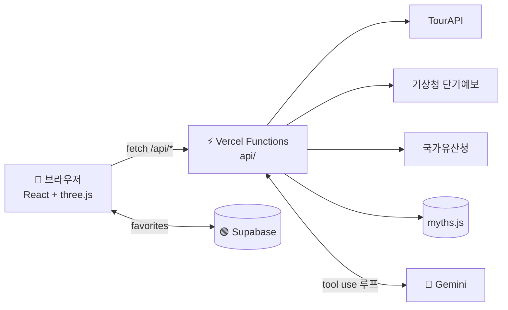

<div align="center">

# 🌙 탐라신화 3D

### 설문대할망의 섬 — 돌려 보고, 눌러 보고, 물어보는 제주 신화 지도


제주대 청년도약 부트캠프 1기 · 제주 콘텐츠·문화 IP 프로젝트

### 🔗 [라이브 데모 → prj-kappa-nine.vercel.app](https://prj-kappa-nine.vercel.app/)


> 휴대폰 카메라로 QR을 스캔하면 배포 사이트로 연결됩니다.

</div>

---

## ✨ 기획 의도

치마폭의 흙으로 한라산을 쌓고, 흘린 흙이 368개의 오름이 되었다는 **설문대할망**.
제주에는 *1만 8천 신*의 이야기가 있지만, 책 속에 머물러 있어 여행자가 만나기 어렵습니다.

**탐라신화 3D**는 신화를 *읽는 콘텐츠*에서 *걸어 다니는 지도*로 바꿉니다.
3D 섬 위의 빛나는 구슬을 누르면 신화가 열리고, 그 신화의 실제 장소·국가유산·날씨까지 공공데이터로 이어집니다.
궁금한 건 **이야기꾼 AI**에게 물어보면, 에이전트가 알아서 도구를 골라 답합니다.

## 🗺️ 주요 기능

| 메뉴 | 설명 |
|---|---|
| 🌌 신화의 섬 | three.js 로 만든 3D 제주. 한라산 지형, 368개 오름, 별·달·파도, 신화·전설·문화 마커 26곳(눌러서 주소·이야기 상세)(분류별로 걸러 보기). 드래그로 회전·휠로 확대. 전체화면 버튼(왼쪽 위에 지금 시각·시간대·날씨 선택) |
| 📖 신화 도감 | 신화·전설 26곳 목록(오른쪽, 이 칸만 스크롤) ↔ 3D 지도(왼쪽)가 같은 선택을 공유. 고르면 카메라가 그 장소로 날아가고, 주변 관광지를 TourAPI 로 찾아옴 |
| 📍 신화 속 장소 | 한국관광공사 TourAPI 검색 결과가 3D 섬 위에 구슬로 표시 |
| 🏛️ 국가유산 | 국가유산청 오픈API 로 제주의 유산을 검색, 좌표를 3D 에 표시 |
| 🤖 이야기꾼 AI | Gemini 에이전트가 신화·관광·날씨·유산 **6개 도구**(신화·지도 이동·관광·날씨·유산·상품)를 스스로 골라 호출하고, 어떤 도구를 썼는지 화면에 공개 |
| 🔐 로그인·회원가입 | Supabase Auth(이메일+비밀번호). 별자리·장바구니·주문이 내 계정에만 보이도록 RLS 로 보호 가입하면 메일 인증 안내(다시 보내기 포함), 인증 링크를 누르면 가입 완료 페이지(`/welcome`)로 도착 |
| 🛍️ 제주 장터 | 제주 특산품·기념품 20종(태그·정렬·별점·찜). 가격은 1분마다, 재고는 10분마다 바뀌는 타임특가에, 드물게 서서히 오르내리고 아주 드물게 급등(최대 +300%)·급락(최대 -95%)(일반판매가를 넘기도 함, 아래 '시세 규칙'). 시세가 바뀌면 바뀐 자리의 숫자가 위에서 아래로 굴러 바뀌고, 상품 상세에 사진 슬라이더·후기·이어진 신화와 1분봉 차트(최고가 빨간 화살표 · 최저가 파란 화살표 · 일반판매가 회색 선) |
| 🧾 장바구니·결제 | 쿠폰 · 적립금 · 등급 혜택(추가 할인·적립률·무료배송 기준) · 배송비를 계산하는 결제 요약. 주문하면 재고가 줄고 취소하면 돌아옴 (실제 결제 없음) |
| 🚚 주문 진행 | 결제완료 → 상품준비중 → 배송중 → 배송완료 단계 표시. 취소는 배송 전, 반품/환불은 배송 후, 배송 후 후기·별점 작성 |
| 🤝 친구 초대 | 내 초대 링크(`/signup?invite=코드`)와 그 링크가 담긴 QR 을 만들어 복사·공유·저장. 친구가 링크로 가입하고 처음 로그인하면 친구는 5,000원 쿠폰, 나는 친구 1명당 3,000원 쿠폰(5명까지)과 3명 달성 10% 쿠폰을 받음. 가입 화면에는 '추천 코드(선택)' 입력란이 있고, 초대 링크로 오면 미리 채워짐. 초대 기록은 Supabase `shop_invites`(RLS) |
| 🔔 알림 | 로그인했을 때만. 메뉴 막대의 종 버튼 → 알림창. 추천 물건(타임특가·급락), 추천 장소(날씨에 맞춘 신화 장소, 6시간마다), 찜한 상품의 가격 하락·재고 부족, 시세 급등락, 주문 상태(상품 준비 중·배송 시작·배송 완료) 소식을 모아 보여주고 누르면 해당 상품·지도로 이동. 마이페이지 '알림 설정'에서 알림 끄기/켜기와 세부 항목(종류별·장소 분류·알림 간격·팝업)을 고르면 바로 저장(로그인하면 계정에도 저장) |
| 🛠️ 시세 관리(관리자) | 관리자 등급(`shop_admins`)만 상품별 시세를 직접 정하고(10분~3시간) 되돌릴 수 있음. 정한 가격은 모든 접속자에게 15초 안에 반영. 쓰기 권한은 DB의 RLS(`is_shop_admin()`)가 막고, 메뉴·페이지는 관리자에게만 보임. 같은 화면에서 관리자가 적립금을 지급·회수: +1,000/+5,000/+10,000 버튼은 누를 때마다 금액이 쌓이고, 받는 사람 이메일을 적으면 그 사람에게(비우면 내 계정) 지급(`shop_point_grants` + 관리자 전용 DB 함수 `grant_points_by_email`, 받은 사람에게 알림, 적립금 내역에 남고 결제에 그대로 쓰임) |
| 🎁 제주 혜택 | 탐나는전(지역사랑상품권) 같은 제주 지역 혜택 안내 + 장터 혜택(타임특가·쿠폰·찜) + 등급별 혜택을 한 페이지에. 지역 혜택 문구는 예시이므로 공식 안내 확인 필요 |
| 🏅 등급·쿠폰 | 누적 구매액으로 일반·실버·골드·VIP·VVIP. 등급 달성 쿠폰 자동 지급, 쿠폰 코드 등록 |
| 👤 마이페이지 | 프로필 사진·닉네임·비밀번호 변경, 주문·배송 현황, 쿠폰함, 적립금, 찜한 상품, 최근 본 상품, 내 후기, 고객센터(FAQ) |
| 🌦️ 날씨 3D | 시간대(새벽·아침·밤)와 기상청 실제 예보(맑음·흐림·비·눈)에 따라 하늘·구름·비·눈이 바뀌는 3D 지도 |
| 🤖 AI가 지도 이동 | "삼성혈 보여 줘"라고 하면 에이전트가 `show_on_map` 도구로 3D 지도를 그 장소로 움직임 |
| ⭐ 내 별자리 | 별표를 누른 신화·장소·유산을 Supabase 에 저장 · 삭제. 별을 누르면 이야기와 Pixabay 사진이 열림 |

## 🌐 사용한 API (공공데이터 3 + 오픈 1)

| # | API | 제공 | 용도 |
|---|---|---|---|
| 1 | 국문 관광정보 서비스 (TourAPI) | 한국관광공사 | 신화 속 장소·문화시설·축제 검색 |
| 2 | 단기예보 조회서비스 | 기상청 | 서귀포·제주시 날씨, 비 오면 실내 대안 제안 |
| 3 | 국가유산 검색 오픈API | 국가유산청 | 신화·민속과 이어진 유산 검색 |
| 4 | 이미지 검색 API | Pixabay | 내 별자리 상세 화면의 관련 사진 |

> 신화 원천 데이터(`server/myths.js`)는 이 프로젝트의 자체 콘텐츠이며, 에이전트의 4번째 도구 `get_myth_story` 로도 쓰입니다.

## 🏗️ 아키텍처



- 키는 서버에만. 공공데이터·Gemini 키는 `/api` 안에서만 쓰고, 브라우저에는 `VITE_` 값(Supabase anon)만 내려갑니다.
- 사진은 서버가 중계. Pixabay 사진을 브라우저가 직접 받으면 요청이 몰릴 때 429 로 깨져서, `/api/img` 가 대신 받아(재시도 포함) 하루 CDN 캐시합니다. 그래도 깨지면 화면이 두 번 다시 불러옵니다.
- `server/` 공용. 화면용 API(`api/tour.js`)와 에이전트(`api/agent.js`)가 같은 함수를 재사용합니다.

### 🧪 에이전트 테스트 질문 4개

배포 사이트(`/api/agent`)에 실제로 물어본 결과입니다 (2026-11-03, Gemini Lite 모델 — 답변이 2~4초). 도구는 질문에 맞춰 에이전트가 스스로 골랐고, 장소와 신화 내용은 도구 결과에 있는 것만 말하도록 시스템 프롬프트로 제한했습니다.

| # | 질문 | 실제 사용한 도구 | 답변 요약 |
|---|---|---|---|
| 1 | 설문대할망 이야기를 들려줘 | `get_myth_story` | 치마에 흙을 날라 한라산을 쌓고 오름 368개를 만든 이야기, 신화 데이터에 있던 제주돌문화공원 안내 |
| 2 | 삼성혈 보여 줘 | `get_myth_story` → `show_on_map` | **3D 지도를 삼성혈로 이동**(`actions: map`)시키고, 신화 데이터의 고을나·양을나·부을나 건국 신화를 소개 |
| 3 | 오늘 서귀포 날씨 알려주고, 비 오면 갈 만한 곳 추천해 줘 | `get_weather` → `search_tour_places`(문화시설 14) | 서귀포 구름 많음·강수 확률 낮음. 실내 대안으로 검색 결과의 감귤박물관·본태박물관·세계자동차&피아노박물관을 추천 |
| 4 | 제주 신화와 관련된 국가유산 알려줘 | `search_heritage` → `get_myth_story` → `search_tour_places` | 검색 결과의 제주 삼성혈(사적)을 신화와 연결하고, 실내 일정으로 국립제주박물관·감귤박물관을 추천 |

> 에이전트는 필요하면 도구를 여러 개 이어서 부르고(최대 5회 반복), 검색 결과가 없으면 없다고 말합니다. 답변에 쓴 도구 목록은 채팅 화면에도 공개됩니다. 모델마다 도구를 고르는 방식이 조금 달라서, 이전 모델(Claude)은 질문마다 도구를 3~4개씩 이어서 불렀습니다.
>
> 한국관광공사 TourAPI 는 지역을 `lDongRegnCd=50`(제주)으로 받아야 결과가 모두 나옵니다. 예전 `areaCode=39` 로는 문화시설이 9곳뿐이었고(지금 97곳), 박물관 검색은 0건이었습니다.

### 이야기꾼 AI 모델

에이전트는 Google **Gemini**(function calling, 무료 사용량)로 동작합니다. [Google AI Studio](https://aistudio.google.com/apikey)에서 무료 키를 받아 서버 환경변수 `GEMINI_API_KEY` 로 넣고, 모델은 `GEMINI_MODEL`(기본 `gemini-3.8-flash`)로 바꿉니다. 모델 이름은 자주 바뀌어서, 옛 모델이 막히면 Google 이 오류 문구로 알려 주는 새 모델로 서버가 한 번 자동으로 다시 시도합니다. 무료 사용량은 분당 호출 수가 적어서 가끔 '사용량이 많아요'가 나올 수 있고(한 번은 자동으로 다시 시도), 그럴 땐 더 가벼운 `flash-lite` 계열 모델로 바꾸면 여유가 있습니다.

### 에이전트 루프

```
질문 → 모델이 도구 선택 → 서버가 도구 실행 → 결과를 모델에 전달 → (반복, 최대 5회) → 최종 답
```

## 🧱 폴더 구조

```
api/          Vercel 서버 함수 (비밀 키는 여기서만)  hello · tour · weather · heritage · agent · pixabay · shop-images · img
server/       공공데이터 호출 + 신화 데이터          tour · weather · heritage · myths
supabase/     schema.sql  (favorites 테이블 + RLS)
src/
  main.jsx          Bootswatch 'vapor' 테마 + 라우터 시작
  router.jsx        메뉴(NAV_ITEMS) + 주소별 페이지 (Router: 이동 경로)
  store/            Zustand 전역 상태 (Store: 공유 내용) — 닉네임·토스트·선택한 신화·즐겨찾기·대화
  layouts/          공통 틀 (메뉴·푸터·토스트)
  components/       Jeju3D(three.js) · Scene(lazy) · ItemCard · WeatherBadge ...
  pages/            Home · Myths · Places · Heritage · Agent · My · Shop · ProductDetail · Cart · Orders · MyPage · Benefits · Login · Signup
```

## 🎮 3D 구현 포인트

- 절차적 지형 — 타원형 섬 + 한라산 가우시안 봉우리를 높이 함수 `heightAt(x, z)` 하나로 만들고, 정점 색을 높이별(모래·초원·암석·정상의 눈)로 칠했습니다. 마커도 같은 함수로 지표면에 얹습니다.
- 날씨의 사실감 — 비와 폭풍은 확실히 다르게 보입니다. 비: 회청색 하늘에 가는 세로줄 비. 폭풍: 훨씬 어두운 하늘과 낮게 깔린 먹구름, 바람에 비스듬히 쏟아지는 굵은 비(돌풍처럼 기울기가 출렁임), 높은 파도와 파도 마루의 흰 거품, 번개가 칠 때 장면 전체가 푸르스름하게 번쩍이며 번개 줄기가 내리꽂힘(`lightning.jsx`). 해안선에는 밀려왔다 빠지는 물결 띠(`Surf`)가 있고 파도가 거칠수록 멀리·진하게 밀려옴
- 바다 (`sea.jsx`) — 바다 면을 잘게 나눠 GPU(정점 셰이더)에서 여러 물결을 겹쳐 출렁이게 하고(빛 반사도 물결 모양대로), 돌고래 6마리가 원을 그리며 헤엄치다 주기적으로 포물선을 그리며 뛰어오릅니다(착수 때 물보라 고리). 돌고래를 누르면 깜짝 놀라 튀어 오르며 옆으로 쓰러졌다가 돌아옵니다. 우도·비양도·차귀도·마라도·가파도·범섬·추자도 같은 주변 섬과, 북쪽 수평선 너머 한반도 남해안(전남·경남, 지리산)을 놓았습니다.
- 섬 풍경 (`landscape.jsx`) — 섬을 1.5배로 키우고, 높이 지도 위에 침엽수·활엽수·야자수 약 1,700그루, 줄 맞춘 감귤밭(주황 열매), 현무암 바위 650개, 돌하르방, 날개가 도는 풍력발전기 11기를 심었습니다. 마우스 판정(raycast)은 꺼서 마커 클릭을 방해하지 않습니다.
- InstancedMesh — 오름 368개를 드로우콜 1번으로. 고정 난수라 누구에게나 같은 섬이 나옵니다.
- 위·경도 → 3D — 실제 좌표를 `toXZ(lat, lng)` 로 변환해 신화 장소가 실제 위치에 놓입니다.
- 카메라 연출 — 선택한 마커로 부드럽게 날아간 뒤 다시 자유 회전.
- 코드 스플리팅 — three.js(≈950 kB)는 `React.lazy` 로 3D 가 필요할 때만 내려받습니다.

## 🚀 실행하기

```bash
npm install
cp .env.example .env.local     # 값 채우기
npm run dev                    # 화면만  → http://localhost:5173
vercel dev                     # 화면 + /api 서버 함수 → http://localhost:3000
```

### 환경변수

| 이름 | 설명 |
|---|---|
| `VITE_SUPABASE_URL` / `VITE_SUPABASE_ANON_KEY` | Supabase 프로젝트 (브라우저 공개 가능) |
| `DATA_GO_KR_KEY` | 공공데이터포털 Decoding 키 (서버 전용) |
| `GEMINI_API_KEY` | Gemini 키 (서버 전용, 절대 커밋 금지. Google AI Studio 에서 무료로 발급) |
| `GEMINI_MODEL` | (선택) 이야기꾼 AI 가 쓸 모델 이름 (기본 `gemini-3.8-flash`) |
| `PIXABAY_KEY` | Pixabay 무료 키 (서버 전용) |

### Supabase 준비

1. 프로젝트 생성 후 SQL Editor 에서 [`supabase/schema.sql`](supabase/schema.sql) 실행 (favorites · cart_items · orders · shop_stock · shop_coupons · shop_reviews · shop_chat_messages · shop_admins · shop_price_override · shop_invites · shop_point_grants · shop_demand 테이블, 재고 함수, 프로필 사진 저장소, RLS. 여러 번 실행해도 안전)
2. Authentication → Providers → Email 에서 Confirm email 을 끄면 가입 즉시 로그인됩니다(수업용). 켜 두면 메일 인증 후 로그인
3. Authentication → URL Configuration 에서 **Site URL** 을 배포 주소(`https://prj-kappa-nine.vercel.app`)로 바꾸고, Redirect URLs 에 `https://prj-kappa-nine.vercel.app/**` 를 추가 (가입 완료 페이지 `/welcome` 으로 돌아오려면 필요. 안 하면 가입 인증 메일의 링크가 다른 사이트로 돌아간다)
4. 첫 화면의 동작 체크 카드가 모두 초록색이면 연결 성공

### 링크 미리보기 · 홈 화면에 앱 추가

- 링크 미리보기(OG): `index.html` 의 `og:title`·`og:description`·`og:image`(`/images/og.png`, 1200×630)·`og:url` — 카톡·슬랙에 주소를 붙이면 큰 사진과 함께 나옵니다.
- 홈 화면에 앱 추가: `public/manifest.webmanifest`(이름 '탐라신화 3D — 설문대할망의 섬' / 짧은 이름 '탐라신화', standalone) + `apple-touch-icon`(`/images/icon-180.png`) + 192·512 아이콘.
  안드로이드는 Chrome 메뉴의 '앱 설치', 아이폰은 Safari 공유 버튼 → '홈 화면에 추가'.

### 단계별 확인 (홈 화면 "동작 체크")

- [x] React · 라우터
- [O] Supabase 연결
- [O] 서버 함수 `/api`

## ☁️ Vercel 배포

1. GitHub 에 push → Vercel 에서 *Import Project*
2. Environment Variables 에 위 4~5개 값 등록
3. Deploy — `vercel.json` 이 SPA 라우팅(`/api` 제외)과 서울 리전(`icn1`)을 설정합니다

## 🎨 디자인

Bootstrap 5 + Bootswatch **vapor**(네온 다크). 신화의 밤하늘에 맞춰 골랐고, `src/main.jsx` 의 테마 이름 한 단어로 전체 분위기를 바꿀 수 있습니다.

## 📄 라이선스 · 출처

데이터 출처: 공공데이터포털 — 한국관광공사, 기상청, 국가유산청. 신화 내용은 구전 설화를 요약·재구성한 것입니다.
